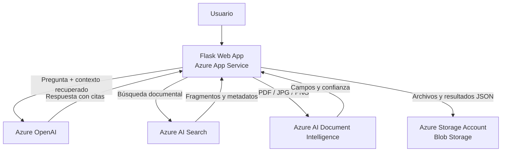

# Proyecto Integrador AI-901 — Río Claro

Aplicación web modular en Flask para automatizar la extracción de datos de facturas y responder preguntas empresariales con generación aumentada por recuperación (RAG). Integra Azure AI Document Intelligence, Azure AI Search, Azure OpenAI y Azure Blob Storage.

> **Alcance académico:** esta solución es una base demostrativa, no un sistema listo para producción. Configura autenticación y autorización, revisión de seguridad, monitoreo, administración de datos y controles operativos antes de exponerla a usuarios reales.

## Contenido

- [Descripción y arquitectura](#descripción-y-arquitectura)
- [Tecnologías](#tecnologías)
- [Estructura](#estructura)
- [Instalación local](#instalación-local)
- [Configuración de Azure](#configuración-de-azure)
- [Ejecución y pruebas](#ejecución-y-pruebas)
- [Despliegue en Azure App Service](#despliegue-en-azure-app-service)
- [GitHub Actions](#github-actions)
- [Evidencias requeridas](#evidencias-requeridas)
- [IA Responsable](#ia-responsable)
- [Seguridad y limitaciones](#seguridad-y-limitaciones)

## Descripción y arquitectura

### Procesamiento de facturas

El formulario acepta PDF, JPG y PNG, valida la extensión y la firma del contenido, y envía el documento al modelo preconstruido `prebuilt-invoice` de Azure AI Document Intelligence. Presenta número de factura, fecha, proveedor, subtotal, impuestos e importe total, además de la confianza por campo. Una confianza **menor a 80%** se marca para revisión humana. Se guarda el archivo fuente y un resultado JSON; localmente se guardan bajo `uploads/`, y con Azure Storage configurado se guardan en Blob Storage.

### Asistente empresarial RAG

Azure AI Search recupera hasta cinco fragmentos del índice configurado. Azure OpenAI recibe únicamente esos fragmentos como contexto, con instrucciones para no usar conocimiento externo y citar fuentes como `[1]`. Si no hay fragmentos recuperados, la aplicación muestra:

> No se encontró información suficiente en los documentos disponibles.

La respuesta generativa no garantiza ausencia de errores: valida las fuentes y el contenido antes de tomar decisiones.

### Diagrama



Consulta también [docs/architecture.md](docs/architecture.md).

## Tecnologías

- Python 3.11+
- Flask, Flask-WTF (protección CSRF) y Bootstrap 5
- Azure AI Document Intelligence SDK
- Azure AI Search SDK
- Azure OpenAI SDK
- Azure Blob Storage SDK
- pytest y GitHub Actions

## Estructura

```text
rio-claro-ai901/
├── app.py
├── config.py
├── requirements.txt
├── .env.example
├── README.md
├── .gitignore
├── services/
│   ├── document_ai.py
│   ├── chatbot_service.py
│   ├── search_service.py
│   └── storage_service.py
├── templates/
│   ├── base.html
│   ├── index.html
│   ├── facturas.html
│   ├── chatbot.html
│   └── about.html
├── static/
│   ├── css/styles.css
│   ├── js/app.js
│   └── images/
├── uploads/
├── docs/
└── tests/
```

Además, `.github/workflows/ci-cd.yml` ejecuta las pruebas y permite desplegar desde la rama `main`.

## Instalación local

En PowerShell, desde la carpeta `rio-claro-ai901`:

```powershell
py -3.11 -m venv .venv
.\.venv\Scripts\Activate.ps1
python -m pip install --upgrade pip
pip install -r requirements.txt
Copy-Item .env.example .env
```

Genera un secreto Flask para desarrollo y completa las credenciales Azure en `.env`. No compartas ni confirmes este archivo en Git:

```powershell
python -c "import secrets; print(secrets.token_hex(32))"
```

Asigna el resultado a `FLASK_SECRET_KEY` en `.env`.

## Configuración de Azure

Completa estas variables en `.env` (no se requieren comillas salvo que el valor las necesite):

| Variable | Descripción |
|---|---|
| `FLASK_SECRET_KEY` | Secreto aleatorio para firmar la sesión y el token CSRF. Obligatorio en despliegues persistentes. |
| `MAX_UPLOAD_MB` | Tamaño máximo de carga; predeterminado: 16 MB. |
| `OPENAI_ENDPOINT` | Endpoint del recurso Azure OpenAI. |
| `OPENAI_KEY` | Clave del recurso (usa Key Vault/identidad administrada en producción cuando sea posible). |
| `OPENAI_DEPLOYMENT` | Nombre de un despliegue de modelo compatible con chat completions. |
| `AZURE_OPENAI_API_VERSION` | Versión API; ejemplo: `2024-06-01`. |
| `SEARCH_ENDPOINT` | Endpoint de Azure AI Search. |
| `SEARCH_KEY` | Clave del servicio de búsqueda. |
| `SEARCH_INDEX` | Índice con documentos empresariales ya indexados. |
| `DOC_INTELLIGENCE_ENDPOINT` | Endpoint del recurso de Document Intelligence. |
| `DOC_INTELLIGENCE_KEY` | Clave del recurso de Document Intelligence. |
| `STORAGE_CONNECTION_STRING` | Cadena de conexión de la cuenta Storage. Si está vacía, se usa almacenamiento local. |
| `STORAGE_CONTAINER` | Contenedor Blob; predeterminado `rio-claro-invoices`. Se crea automáticamente si no existe. |

### Preparar Azure AI Search

La aplicación consulta un índice ya existente; no crea el índice ni ingiere documentos automáticamente. Usa Azure AI Search (por ejemplo, el asistente de importación de datos o un proceso de indexación) para cargar políticas, catálogos, inventario y preguntas frecuentes. El índice debe exponer:

- Un campo de texto buscable llamado `content`; también se reconocen `text` o `chunk`.
- Opcionalmente, `title` y `source` (o `metadata_storage_name` / `metadata_storage_path`) para mostrar referencias legibles.
- Un campo clave, normalmente `id`, según el esquema que configures en el servicio.

Aplica permisos y filtros apropiados para que cada usuario solo pueda recuperar documentos que está autorizado a consultar. No indexar información no aprobada.

## Ejecución y pruebas

Con el entorno virtual activado y `.env` configurado:

```powershell
python app.py
```

Abre <http://127.0.0.1:5000>. Los servicios Azure sin configurar muestran un aviso y no son simulados. El módulo de facturas necesita Document Intelligence; RAG necesita Azure AI Search, Azure OpenAI y un índice con contenido.

Ejecuta las pruebas unitarias:

```powershell
pytest -q
```

Las pruebas usan dobles de prueba y no requieren una suscripción Azure ni credenciales reales.

## Despliegue en Azure App Service

1. Crea un grupo de recursos y recursos de Azure OpenAI, Azure AI Search, Document Intelligence y una cuenta Storage con contenedor Blob. Crea o despliega el modelo de chat y carga documentos en el índice de búsqueda.
2. Crea una **Web App** de App Service para Linux con Python 3.11. Configura el comando de inicio:

   ```text
   gunicorn --bind=0.0.0.0 --timeout 600 app:app
   ```

3. En **Configuration > Application settings**, agrega todas las variables requeridas. Genera un valor criptográficamente aleatorio para `FLASK_SECRET_KEY`; no uses el secreto generado automáticamente por la aplicación para un entorno persistente. Configura `MAX_UPLOAD_MB` según los límites de App Service y tus necesidades. Para ZIP deploy con instalación de dependencias en App Service, agrega también `SCM_DO_BUILD_DURING_DEPLOYMENT=true`.
4. Asigna a la identidad de la Web App únicamente los permisos necesarios para acceder a los recursos. Para un entorno real, sustituye claves/cadenas de conexión por identidad administrada y Azure Key Vault donde sea compatible, activa HTTPS y establece una política de retención para facturas.
5. Despliega desde GitHub Actions (ver abajo) o configura el repositorio en **Deployment Center**. Comprueba los logs de App Service y realiza una prueba controlada con datos no sensibles.
6. Valida acceso, citas RAG, campos/confianza de factura, almacenamiento, límites de carga, errores y recuperación antes de habilitar a usuarios.

Para Blob Storage, la aplicación crea el contenedor indicado si aún no existe. Asegúrate de que las credenciales tengan permiso de escritura. Para Azure AI Search y Document Intelligence, las claves/endpoints deben corresponder al mismo servicio y región correctos.

## GitHub Actions

El workflow `.github/workflows/ci-cd.yml` instala dependencias, ejecuta `pytest` y despliega tras un push a `main` o ejecución manual. Para habilitar el despliegue:

1. En GitHub, agrega el secreto del repositorio o del environment `production`: `AZURE_WEBAPP_PUBLISH_PROFILE` (contenido del perfil de publicación descargado desde App Service).
2. Agrega la variable `AZURE_WEBAPP_NAME` con el nombre de la Web App.
3. Protege la rama `main` y configura aprobación del environment `production` si corresponde.
4. Configura las variables de aplicación y secretos de Azure directamente en App Service, no en el workflow.

Para producción, se recomienda evolucionar de perfil de publicación a autenticación federada OIDC con Azure.

## Evidencias requeridas

Para la entrega académica, recopila evidencias sin exponer claves ni información personal:

1. Página de inicio y navegación responsive.
2. Carga de una factura de prueba, valores extraídos, confianza y advertencia de un campo bajo 80%.
3. Registro JSON generado y evidencia de almacenamiento local o Blob Storage usando datos ficticios.
4. Pregunta empresarial respondida con fuentes visibles y ejemplo sin resultados que muestre el mensaje requerido.
5. Pruebas ejecutadas correctamente (`pytest -q`).
6. Recursos Azure desplegados y configuración de App Service (censura secretos, endpoints privados y datos sensibles).
7. Evidencia del workflow de GitHub Actions completado exitosamente.
8. Revisión de accesibilidad y controles de IA Responsable.

## IA Responsable

La página **Acerca del proyecto** y [docs/responsible-ai.md](docs/responsible-ai.md) documentan los seis principios:

1. **Equidad:** no se automatizan decisiones sobre personas; se recomienda validar desempeño en distintos tipos y calidades de factura.
2. **Inclusión:** interfaz adaptable, etiquetas semánticas y contenido en español; se recomienda evaluar accesibilidad con usuarios y lectores de pantalla.
3. **Confiabilidad y seguridad:** validación de extensión y firma, tamaño máximo, control de confianza y supervisión humana; producción requiere pruebas y monitoreo adicionales.
4. **Privacidad:** credenciales mediante variables de entorno; producción requiere mínimo privilegio, Key Vault/identidad administrada y retención definida.
5. **Transparencia:** el chatbot expone fuentes, indica ausencia de evidencia y las facturas muestran confianza por campo.
6. **Rendición de cuentas:** las salidas requieren verificación humana y deben existir responsables, auditoría proporcional y mecanismos de corrección.

## Seguridad y limitaciones

- No guardes `.env`, perfiles de publicación, facturas reales ni claves en el repositorio.
- El nombre de archivo se normaliza, la extensión debe estar permitida y el contenido debe comenzar con la firma esperada; la interfaz también limita el tamaño.
- Los formularios tienen protección CSRF. Jinja escapa contenido mostrado en HTML.
- Los errores operativos se registran en el log y se informa al usuario sin mostrar trazas.
- Esta versión no incorpora inicio de sesión, autorización por rol, límites de tasa ni un flujo de aprobación de facturas. No la expongas sin esos controles.
- Las instrucciones del chatbot y la recuperación reducen respuestas no fundamentadas, pero no garantizan exactitud. Evalúa el sistema con datos representativos y supervisión.
- Los documentos y respuestas pueden contener datos sensibles; limita acceso, registros, retención y uso según las políticas de la organización.
