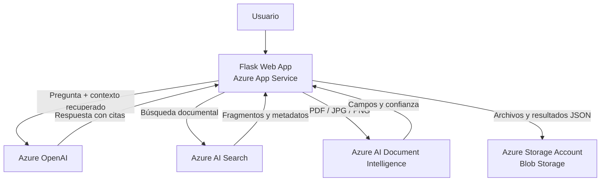

# Arquitectura

## Límites y responsabilidades

- Flask coordina las solicitudes web, valida entradas y presenta las respuestas.
- `document_ai.py` analiza facturas con el modelo preconstruido `prebuilt-invoice`.
- `search_service.py` recupera fragmentos indexados. El índice debe existir y contener un campo `content` (o `text`/`chunk`) y, de ser posible, campos `title` y `source`.
- `chatbot_service.py` compone el contexto recuperado, solicita una respuesta fundamentada y retorna las fuentes.
- `storage_service.py` almacena el archivo y el resultado JSON en Blob Storage; sin cadena de conexión persiste localmente para desarrollo.
- En producción se recomienda configurar autenticación, identidad administrada, Key Vault, monitoreo y retención de datos.
